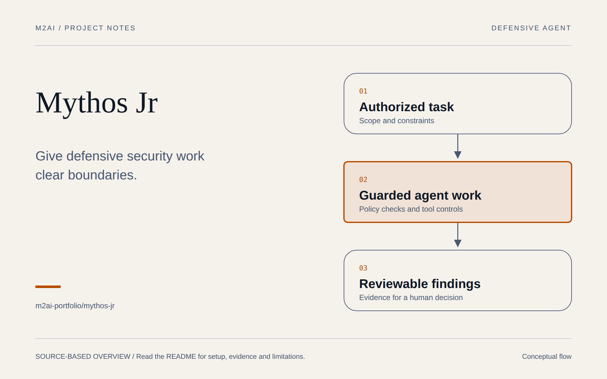

# Mythos Jr



When a security review finds a suspicious function, a useful assistant should help explain the bug and check a repair without gaining authority over the whole system. Mythos Jr is a defensive security worker built around that boundary: a separate host supplies an authorized task, the worker applies tool controls, and the operator reviews the findings and audit trail.

The project combines the Claude Agent SDK with an A2A HTTP interface. It demonstrates bounded task dispatch, refusal logic, workspace guards, and an explicit split between the component that decides and the component that acts.

**Status:** MIT-licensed worker package, version `1.0.0` in this source snapshot. No hosted instance, web UI, or bundled host agent. It runs as a host process unless you supply external isolation.

## What it is for

| Skill | Intended task |
|---|---|
| `vulnerability_triage` | Inspect authorized source, identify a suspected vulnerability, and propose a repair. |
| `patch_verification` | Add a regression test and check a patch without changing existing tests. |
| `safe_exploit_reproduction` | Reproduce a vulnerability in an isolated environment, with written ownership attestation. |

The worker does not initiate work or approve its own scope. See [host integration](docs/HOST_INTEGRATION.md) and [host audit checks](host/host_checks.md) before building a dispatcher.

## Set up from source

Requires Node.js 20 or newer, npm, and an Anthropic API key for model-backed tasks. API tasks incur provider charges. Loading the source or building the project does not prove that authentication or task execution works.

```bash
git clone https://github.com/m2ai-portfolio/mythos-jr.git
cd mythos-jr
npm install
npm run build
node dist/cli.js --help
```

Supply `ANTHROPIC_API_KEY` through your approved environment or secret manager. On the author's ProBook, source `~/.env.shared` in the launch shell. Keep credentials outside the repository.

Create a dedicated work directory and place the audit log outside that directory:

```bash
mkdir -p mjr-workspace
node dist/cli.js --workspace ./mjr-workspace --audit-log ./mjr-audit.log
```

The CLI defaults to a loopback-only A2A listener on port `8080` and a health sidecar on `9090`. Stop it with **Ctrl+C**. The A2A endpoint has no authentication, so widening `--host` requires an appropriate network boundary and access controls. This is an API worker, not a browser application.

The repository also documents npm distribution as `@m2ai/mythos-jr`. For the package-based route and request examples, use [the quickstart](docs/QUICKSTART.md).

## First walkthrough

1. Read [security-policy.json](security-policy.json) and identify the worker's limits before sending it work.
2. Start the worker with a real workspace and a separate audit-log path.
3. Follow the quickstart's self-contained `vulnerability_triage` request. It asks for a short analysis of a supplied code snippet and does not need a source mount.
4. Check the returned A2A task status and artifact. A listening server or healthy sidecar alone is not proof that a model task succeeded.
5. Inspect `mjr-audit.log` for the corresponding task events and tool decisions. If authentication fails, correct the launch environment and restart.
6. Before using real source, define ownership, permitted reads, permitted writes, and the host's acceptance checks.

## Design and controls

The [server implementation](src/server.ts) contains startup refusal checks, tool permission handling, workspace path validation, command classification, retry caps, and nonce checks for referenced tool output. The CLI exposes `--workspace`, `--policy`, `--audit-log`, `--host`, `--port`, and `--health-port`.

The default policy aims to prevent unauthorized targets, permission-prompt simulation, Git history changes, public artifact posting, and edits to existing tests during verification. These controls are defense in depth, not a proof that arbitrary model behavior is safe. The nonce check rejects unknown nonce references; it is not a general truth detector for every statement in an artifact.

## Operational boundaries

- The process is not an OS sandbox. Use a dedicated OS user and external isolation appropriate to the task.
- Keep the installation and audit log outside the worker's writable workspace.
- Enforce network egress at the firewall or network namespace level; a policy file alone cannot enforce every network path.
- Exploit reproduction requires a dedicated isolated environment. Review the tradeoffs in [docs/Dockerfile.reference](docs/Dockerfile.reference).
- The user supplies the host agent and its independent review. See [PLAN.md](PLAN.md) for the design rationale and source references, and [ROADMAP.md](ROADMAP.md) for future work.

## Development checks

```bash
npm run build
npm test
npm run lint
```

These commands come from [package.json](package.json). They check the source and tests; real provider authentication, sandboxing, firewall behavior, and host integration need separate validation in your environment.

Built by Matthew Snow / [M2AI](https://memyselfplusai.com), using Anthropic's Claude Agent SDK and the A2A JavaScript SDK. [MIT license](LICENSE).
